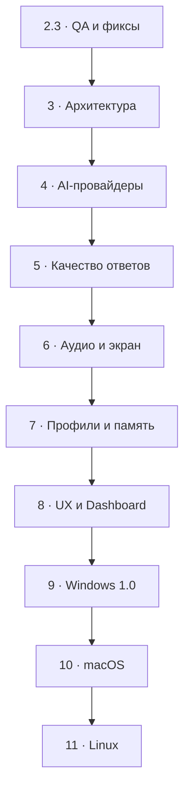
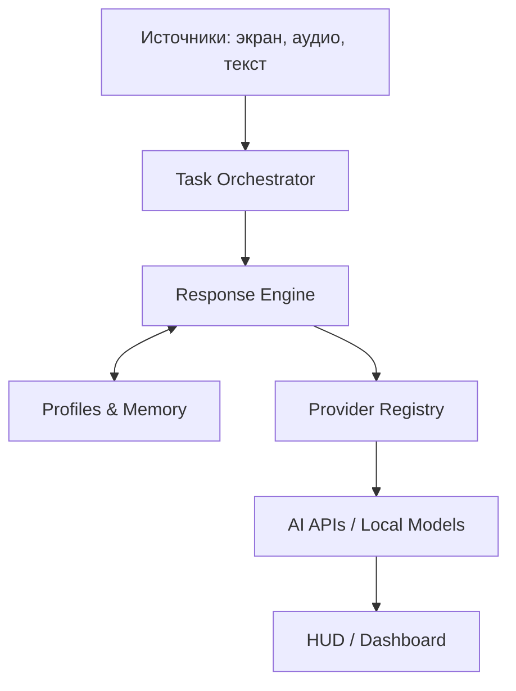

# 👻 GhostAssist — Development Roadmap

> **План развития:** от рабочего Windows-прототипа к стабильному, расширяемому AI-приложению с несколькими провайдерами, качественными ответами и последующей поддержкой macOS/Linux.
>
> **Редакция:** 1.0 · **Дата:** 06.11.2026 · **Статус:** проект плана, этапы и сроки уточняются после технического аудита.

---

## 🎯 1. Видение продукта

**GhostAssist** — персональный AI-помощник для анализа информации с экрана, распознавания речи, изучения материалов и подготовки структурированных ответов. Пользователь управляет источниками данных, профилями, провайдерами моделей и историей.

### Основные цели

1. **Надёжность:** функции работают предсказуемо, ресурсы освобождаются, ошибки не приводят к потере управления приложением.
2. **Качество ответов:** ответы корректные, понятные, соответствуют задаче и выбранному профилю; качество измеряется контрольными примерами.
3. **Независимость от провайдера:** Gemini, OpenAI, Claude, Ollama и совместимые API подключаются через единый интерфейс.
4. **Гибкие источники:** экран, выделенная область, системный звук, микрофон, текст и документы.
5. **Персонализация:** профили, режимы ответа, память и настройки отдельных рабочих пространств.
6. **Приватность:** явное управление захватом, минимизация собираемых данных, безопасное хранение ключей.
7. **Кроссплатформенность:** сначала качественный Windows-релиз, затем macOS и Linux без переписывания бизнес-логики.

### Вне рамок roadmap

- Обещания полной невидимости для любого мониторинга или механизмов обхода контроля сторонних платформ.
- Автоматический сбор аудио/экрана без понятного действия пользователя и необходимых разрешений.
- Переписывание всего приложения «с нуля» ради модной технологии.

---

## 📍 2. Точка старта

| Этап | Состояние на момент составления плана | Что уже получено |
|---|---|---|
| Stage 1 — Stability | ✅ Реализован | Управление задачами, отмена, улучшенный WASAPI, Dashboard, устойчивость HUD |
| Stage 2 — Context & Audio | ✅ Реализован | RAM-память, транскрибация Gemini, VAD, выбор устройства |
| Stage 2.1 — Audio Queue | ✅ Реализован | Непрерывный захват с ограниченной FIFO-очередью |
| Stage 2.2 — Background Mode | ✅ Объединён в `main` | Трей, скрытие Dashboard, Single Instance, управление службой |
| Stage 2.2.1 — Hotkey Editor | ✅ Объединён в `main` | Редактор хоткеев, валидация, UX назначения; дополнительная ручная проверка входит в Stage 2.3 |

**Важно:** изменения Stage 1–2.2.1 объединены в `main`. Полная функциональная проверка на реальных устройствах остаётся задачей Stage 2.3.

### Технические ограничения текущей версии

- Основной LLM-провайдер — Gemini.
- Захват системного аудио привязан к Windows/WASAPI.
- GUI основан на Tkinter/CustomTkinter, жизненный цикл службы частично связан с Dashboard.
- Режимы ответов используют достаточно жёсткое текстовое форматирование.
- История хранится преимущественно в оперативной памяти.
- Реальное поведение некоторых сценариев зависит от драйверов, ОС и конкретного устройства.

---

## 🗺️ 3. Сводная карта этапов

| Очередь | Этап | Главный результат | Приоритет | Оценка* |
|---|---|---|---|---|
| 1 | **2.3 — Quality & Stability** | Полный аудит, исправление багов, тесты, CI, стабильная база | 🔴 P0 | 1–3 нед. |
| 2 | **3 — Architecture 2.0** | Независимое ядро, адаптеры, стандартизированные события | 🔴 P0 | 2–3 нед. |
| 3 | **4 — Multi-Provider AI** | Gemini / OpenAI / Claude / Ollama / custom API | 🔴 P0 | 2–4 нед. |
| 4 | **5 — Response Engine 2.0** | Качественные структурированные и адаптивные ответы | 🔴 P0 | 2–4 нед. |
| 5 | **6 — Audio & Vision 2.0** | Улучшенные источники, OCR, STT, захват нескольких мониторов | 🟠 P1 | 2–4 нед. |
| 6 | **7 — Profiles & Memory 2.0** | Рабочие пространства, профили и постоянная память | 🟠 P1 | 1–3 нед. |
| 7 | **8 — Dashboard & UX 3.0** | Удобное управление всеми возможностями | 🟠 P1 | 2–3 нед. |
| 8 | **9 — Windows 1.0** | Установщик, обновления, миграции, релиз | 🟠 P1 | 2–3 нед. |
| 9 | **10 — macOS** | Платформенные адаптеры и подписанное приложение | 🟡 P2 | 3–6 нед. |
| 10 | **11 — Linux** | X11/Wayland, PipeWire, упаковка для дистрибутивов | 🟡 P2 | 3–6 нед. |

\* Оценки ориентировочные для последовательной разработки; они **не являются обещанными сроками**. Задачи с драйверами и межплатформенными API могут потребовать значительно больше времени.

---

# 🔴 STAGE 2.3 — Quality & Stability

> **Приоритет №1.** Прежде чем добавлять новые функции, нужно провести полноценную проверку всего GhostAssist, устранить обнаруженные дефекты и получить воспроизводимую, измеримую стабильность. «Довести до идеала» здесь означает закрыть критические и существенные дефекты, определить известные ограничения и обеспечить защиту от регрессий.

**Статус: PENDING ACCEPTANCE.** Код готов к интеграции, автоматические проверки успешны; оставшиеся реальные Windows-проверки и ограничения перечислены в [отчёте Stage 2.3](docs/audits/STAGE_2_3_FINAL_REPORT.md). Этап не считается принятым до выполнения критериев ниже.

## 2.3.1. Аудит исходного кода и архитектуры

- [ ] Проверить актуальное состояние всех веток и историю изменений Stage 1–2.2.1.
- [ ] Составить карту компонентов, потоков, очередей и жизненного цикла процессов.
- [ ] Найти циклические зависимости, глобальные состояния и гонки.
- [ ] Проверить корректность обращения с Tkinter: GUI меняется только из главного потока.
- [ ] Проверить корректность остановки потоков, listeners, очередей и сетевых запросов.
- [ ] Отметить дублирующуюся логику, недостижимый код и потенциальные утечки.
- [ ] Зафиксировать технический долг в `docs/TECH_DEBT.md`.

## 2.3.2. Полная функциональная ревизия

Проверить **каждый пользовательский сценарий**, в том числе:

- [ ] Первый запуск без `.env` и без API-ключа.
- [ ] Сохранение, загрузка и проверка настроек.
- [ ] Создание, редактирование, выбор и сохранение Markdown-профиля.
- [ ] Назначение, сброс, отмена и переопределение горячих клавиш.
- [ ] Блокировка конфликтующих и системных комбинаций.
- [ ] Запуск и остановка управляемой службы.
- [ ] Повторный запуск Dashboard и `main.py` (Single Instance).
- [ ] Скрытие/восстановление из трея, кнопка X, аварийное завершение родителя.
- [ ] Сохранение PID, памяти и текущей задачи при скрытии Dashboard.
- [ ] Полный экран, выделенная область, несколько мониторов, нестандартный DPI.
- [ ] Отображение, позиционирование, скролл, очистка и масштаб HUD.
- [ ] Отмена скриншота, транскрибации, Gemini-запроса и VAD.
- [ ] Переключение TEST/INTERVIEW и корректность контекста.
- [ ] Корректное завершение приложения без зависших процессов.

## 2.3.3. Аудио, VAD и очереди

- [ ] Проверить реальный WASAPI Loopback на нескольких устройствах.
- [ ] Проверить тишину, музыку, русский и английский голос.
- [ ] Проверить отключение устройства во время записи и восстановление.
- [ ] Проверить неправильное имя устройства и неоднозначные имена.
- [ ] Проверить предел длительности и памяти PCM/WAV.
- [ ] Проверить непрерывный захват во время транскрибации и генерации.
- [ ] Проверить FIFO, повторяющиеся фразы, повторные ID и переполнение.
- [ ] Проверить глобальную отмену и отмену только текущей реплики.
- [ ] Убедиться, что ни один поток не продолжает бесконтрольно работать после остановки.
- [ ] Проверить корректность счётчика потерянных сегментов.

## 2.3.4. Gemini, сеть и обработка ошибок

- [ ] Проверить валидный, пустой и неверный API-ключ.
- [ ] Проверить ошибки доступа, квоты и ограничения частоты.
- [ ] Смоделировать сетевой тайм-аут, обрыв потока и 5xx.
- [ ] Проверить отмену до отправки, во время запроса и во время streaming.
- [ ] Убедиться, что устаревшие ответы после отмены не попадают в HUD/память.
- [ ] Проверить корректность fallback и общий бюджет времени.
- [ ] Исключить бесконечные повторы и повторные списания из-за ошибок клиента.
- [ ] Проверить корректность обработки пустых/частичных/неформатированных ответов.

## 2.3.5. Производительность и ресурсы

- [ ] Сделать базовые замеры RAM/CPU в простое, при записи и при генерации.
- [ ] Измерить время до первого полезного фрагмента ответа и полное время задачи.
- [ ] Проверить 100 последовательных тестовых запросов с моками.
- [ ] Проверить 20 циклов запуска/остановки службы.
- [ ] Проверить 20 циклов скрытия/открытия Dashboard.
- [ ] Провести длительный тест VAD с контролем очередей и памяти.
- [ ] Устранить подтверждённые утечки, зависания и деградацию после повторных операций.
- [ ] Зафиксировать результаты до/после исправлений.

## 2.3.6. Безопасность и приватность

- [ ] Исключить попадание API-ключей и содержимого разговоров в диагностические логи по умолчанию.
- [ ] Проверить обработку путей профилей и работу с файлами.
- [ ] Проверить отсутствие неожиданных записей аудио/изображений на диск.
- [ ] Сделать явную индикацию активного захвата и понятное управление им.
- [ ] Проверить, что сохранение настроек не повреждает `.env` при ошибке записи.
- [ ] Задокументировать границы работы API захвата окон и разрешений ОС.

## 2.3.7. Автотесты и CI

- [ ] Сохранить имеющиеся unit-тесты и дополнить регрессионными.
- [ ] Добавить интеграционные тесты с подставными Gemini и WASAPI.
- [ ] Подготовить отдельные проверки обработки ошибок и отмены.
- [ ] Добавить GitHub Actions для Python 3.10–3.12.
- [ ] Добавить `ruff check`, `ruff format --check`, `compileall`.
- [ ] Добавить Windows-runner для автоматизируемых сценариев.
- [ ] Отдельно описать тесты с реальными устройствами, которые CI не может воспроизвести.
- [ ] Настроить отчёт о проваленных тестах и блокировку слияния при красном CI.

## 2.3.8. Bug triage и исправления

Для каждой найденной проблемы создать запись с:

| Поле | Содержание |
|---|---|
| ID | `BUG-001` и далее |
| Severity | P0 / P1 / P2 / P3 |
| Шаги воспроизведения | Что нажать, какие входные данные |
| Ожидаемый результат | Как приложение должно работать |
| Фактический результат | Что происходит сейчас |
| Root cause | Подтверждённая причина |
| Исправление | Файл/коммит/PR |
| Регрессия | Тест, не позволяющий багу вернуться |

**P0** — падение, потеря данных, критическая проблема безопасности. **P1** — основная функция систематически не работает. **P2** — частичная поломка или обходной путь. **P3** — косметика и небольшие неудобства.

### ✅ Критерии завершения Stage 2.3

- [ ] Нет открытых P0 и P1.
- [ ] Все основные сценарии проверены на реальной Windows 11; критичные сценарии дополнительно проверены на Windows 10.
- [ ] Нет подтверждённых утечек и зависших процессов в циклических тестах.
- [ ] Автотесты, Ruff и сборка проходят в CI.
- [ ] Есть ручной smoke-checklist и документ с известными ограничениями.
- [ ] Все исправления сопровождаются тестом или обоснованием, почему автоматизация невозможна.
- [ ] Результат оформлен релизным тегом, например `v0.3.0`.

---

# 🔴 STAGE 3 — Architecture 2.0

**Статус: IN PROGRESS** — Stage 3.1: доменные контракты; Stage 3.2: оркестратор подключён к полноэкранному захвату; Stage 3.3: контракты и адаптер Gemini для генерации и транскрибации; Stage 3.4–3.5 запланированы. Архитектурные решения и порядок миграции: [проект Stage 3](docs/architecture/STAGE_3_DESIGN.md). Значимые изменения сопровождаются обновлением README, архитектуры, Roadmap и истории изменений в том же PR по затронутой области.

**Цель:** расширять проект без жёсткой привязки основного кода к Gemini, WASAPI и CustomTkinter.

## Задачи

- [ ] Выделить независимые доменные сущности: `Request`, `Response`, `Task`, `Session`, `Profile`, `ProviderCapabilities`.
- [ ] Ввести единые события жизненного цикла задачи: `STARTED`, `PROGRESS`, `CHUNK`, `COMPLETED`, `CANCELLED`, `FAILED`.
- [ ] Создать единый оркестратор с отменой, тайм-аутами, очередями и приоритетами.
- [ ] Выделить интерфейс провайдера генерации и отдельно — интерфейс транскрибации.
- [ ] Создать абстракции `ScreenCapture`, `AudioCapture`, `HotkeyBackend`, `NotificationBackend`.
- [ ] Отделить UI-события от фоновых потоков и сетевых вызовов.
- [ ] Сделать типизированные ошибки и единый формат диагностики.
- [ ] Ввести версионируемую схему настроек с миграциями.
- [ ] Переносить существующие компоненты по одному, без полной переписи.

## Целевой поток данных

### ✅ Критерии завершения

- [ ] Core не импортирует GUI и Windows-специфичные библиотеки.
- [ ] Тестовый provider подключается без редактирования оркестратора.
- [ ] Платформенные операции заменяемы моками.
- [ ] Функции Stage 2.3 не регрессировали.

---

# 🔴 STAGE 4 — Multi-Provider AI

**Цель:** выбирать модель и провайдера для каждой задачи, а не зависеть от одного Gemini API.

## Провайдеры по очереди

| Очередь | Провайдер | Область применения |
|---|---|---|
| 1 | **Google Gemini** | Перенос существующей интеграции на общий интерфейс |
| 2 | **OpenAI** | Текст, изображения и подходящие аудиовозможности |
| 3 | **Anthropic Claude** | Текст и изображения в рамках возможностей выбранной модели |
| 4 | **Ollama** | Локальные модели; опционально совместимые удалённые модели |
| 5 | **Custom OpenAI-compatible** | Пользовательский `base_url`, модель и ключ |

## Функциональность

- [ ] Реестр провайдеров с единым API.
- [ ] Матрица возможностей каждой модели: `text`, `vision`, `audio_input`, `streaming`, `structured_output`, `tools`.
- [ ] Список моделей и проверка доступа в Dashboard.
- [ ] Отдельные настройки подключения, ключей, тайм-аутов, лимитов и прокси для каждого провайдера.
- [ ] Возможность выбирать модель генерации и модель транскрибации независимо.
- [ ] Настраиваемая последовательность fallback.
- [ ] Переход к резервному провайдеру **только с разрешёнными пользователем данными и при совместимости модальностей**.
- [ ] Единая обработка ошибок авторизации, квот, сети, тайм-аута и отмены.
- [ ] Потоковая выдача ответа независимо от SDK.
- [ ] Оценка расходов и пользовательские лимиты бюджета без обещаний точного биллинга.
- [ ] Локальный режим без облачной отправки при использовании подходящей локальной модели.

### ✅ Критерии завершения

- [ ] Пользователь добавляет API через Dashboard без правки кода.
- [ ] Одинаковый тестовый запрос проходит минимум через два реальных независимых провайдера.
- [ ] Несовместимая модель не получает неподдерживаемое изображение/аудио.
- [ ] Ошибки и fallback покрыты contract-тестами.

---

# 🔴 STAGE 5 — Response Engine 2.0

**Цель:** измеримо улучшить точность, скорость и удобство ответов.

## 5.1. Режимы ответа

| Режим | Назначение |
|---|---|
| `QUICK` | Краткий тезис в 1–3 предложениях |
| `STANDARD` | Короткий ответ + объяснение |
| `DETAILED` | Подробный разбор и примеры |
| `TECHNICAL` | Точные термины, примеры, ограничения |
| `CODE` | Код, анализ сложности, тест-кейсы |
| `SYSTEM_ANALYST` | Требования, API, BPMN/UML/ERD, критерии приёмки |
| `INTERVIEW_PRACTICE` | Естественный ответ для репетиции интервью |
| `LEARNING` | Пошаговое объяснение и контроль понимания |

## 5.2. Новая обработка ответов

- [ ] Перейти от хрупкого парсинга строк `Вопрос:`/`Ответ:` к типизированной структуре.
- [ ] Поддержать неполный streaming-ответ и его безопасную финализацию.
- [ ] Разделять `short_answer`, `explanation`, `examples`, `code`, `caveats`, `sources`.
- [ ] Сделать краткую и расширенную версии одного результата.
- [ ] Поддержать ответы с Markdown, кодом, таблицами и математическими выражениями.
- [ ] Создать библиотеку версионируемых prompt templates.
- [ ] Отделить инструкции профиля от фактов, полученных из документов и экрана.
- [ ] Не приписывать модели фиктивную «уверенность 99%»; явно показывать недостаток данных.
- [ ] Ввести режим запроса уточнения при неоднозначном вопросе.
- [ ] Поддержать проверку готового ответа вторым проходом или второй моделью как опциональную функцию.

## 5.3. Измерение качества

- [ ] Собрать контрольный набор русских и английских вопросов: программирование, SQL, системный анализ, общие знания.
- [ ] Ввести эталонные критерии, а не только сравнение текста с одним «правильным ответом».
- [ ] Измерять корректность, полноту, соблюдение формата, задержку и стоимость.
- [ ] Сравнивать версии промптов и моделей на одинаковом наборе.
- [ ] Отдельно измерять качество понимания скриншотов и транскрибации.

### ✅ Критерии завершения

- [ ] Все ответы проходят через один типизированный pipeline.
- [ ] Пользователь выбирает режим и глубину ответа без редактирования системного промпта.
- [ ] Есть воспроизводимый отчёт «до/после» на контрольных заданиях.

---

# 🟠 STAGE 6 — Audio & Vision 2.0

## Аудио

- [ ] Независимый выбор системного звука, микрофона или обоих источников.
- [ ] Раздельные каналы для разных источников без случайного смешивания.
- [ ] Проверка уровня входа, устройства и частоты дискретизации.
- [ ] Улучшенная сегментация речи на границах фраз.
- [ ] Настраиваемые стратегии переполнения очереди с явным счётчиком потерь.
- [ ] Выбор локального/облачного STT-провайдера.
- [ ] Определение языка и улучшенная работа с русской/английской речью.
- [ ] Редактирование и подтверждение транскрипта, повторная транскрибация.
- [ ] Шумоподавление и дополнительные VAD-модели — только после сравнительных измерений.

## Экран и текст

- [ ] Выбор конкретного монитора или окна.
- [ ] Улучшенная работа с несколькими DPI и необычным расположением мониторов.
- [ ] Предпросмотр области перед отправкой.
- [ ] Локальный OCR с возможностью исправить распознанный текст.
- [ ] Обработка таблиц, диаграмм и нескольких вопросов в одном изображении.
- [ ] Кэширование неизменившегося изображения там, где это не искажает результат.
- [ ] Настраиваемые ограничения размера, качества и объёма данных.
- [ ] Дополнительный ручной ввод текста и импорт TXT/MD/PDF.

### ✅ Критерии завершения

- [ ] Независимые источники работают через единый интерфейс ввода.
- [ ] Устройство можно сменить и безопасно отключить.
- [ ] Контрольные тесты подтверждают, что распознавание не стало хуже базовой версии.

---

# 🟠 STAGE 7 — Profiles & Memory 2.0

## Профили и рабочие пространства

- [ ] Создание, редактирование, импорт, экспорт и дублирование профилей.
- [ ] Категории и теги: Go, Python, DevOps, System Analyst, General и другие.
- [ ] Настройки модели, режима ответа, языка и стиля для каждого профиля.
- [ ] Переключение профиля без потери целостности активной задачи.
- [ ] История версий профиля и восстановление прошлой редакции.
- [ ] Шаблоны профилей из поставки приложения.

## Память

- [ ] Опциональная постоянная история в SQLite.
- [ ] Разделение истории по рабочим пространствам и режимам.
- [ ] Ограничение глубины, размера и срока хранения.
- [ ] Поиск, просмотр, правка и удаление отдельных записей.
- [ ] Краткие сводки длинных сессий для уменьшения контекста.
- [ ] Экспорт истории и полная очистка по запросу пользователя.
- [ ] Безопасное хранение данных и отсутствие постоянной записи по умолчанию.

### ✅ Критерии завершения

- [ ] История не смешивается между профилями без явного решения пользователя.
- [ ] Сессии можно полностью удалить.
- [ ] Повреждённая БД не блокирует запуск приложения.

---

# 🟠 STAGE 8 — Dashboard & UX 3.0

## Новая структура Dashboard

| Раздел | Что отображать |
|---|---|
| **Overview** | Служба, активная задача, последние ошибки |
| **AI Providers** | API, модели, тест подключения, fallback |
| **Profiles** | Роли, шаблоны, редактор |
| **Capture** | Экран, устройство, микрофон, VAD, OCR |
| **Responses** | Режимы, формат, длина, качество |
| **Memory** | Сессии, глубина, хранение, очистка |
| **Hotkeys** | Интерактивное назначение, конфликты, сброс |
| **Diagnostics** | Статусы, задержки, очередь, ошибки |
| **Settings** | Общие настройки, импорт/экспорт, обновления |

## Улучшения

- [ ] Простой и расширенный режим настройки.
- [ ] Поиск по параметрам и контекстные подсказки.
- [ ] Переключение провайдеров без перезапуска, когда это технически безопасно.
- [ ] Приятные состояния загрузки, ошибок и пустых списков.
- [ ] Управление размером, шрифтом, прозрачностью, положением и прокруткой HUD.
- [ ] Компактный и полный формат отображения ответа.
- [ ] Копирование текста/кода и раскрытие подробностей.
- [ ] Корректная работа фокуса, масштабирования и клавиатурной навигации.
- [ ] Светлая/тёмная тема — после завершения основной функциональности.

### ✅ Критерии завершения

- [ ] Основные настройки доступны без изменения `.env` вручную.
- [ ] UI не зависает из-за API, транскрибации или записи.
- [ ] Любая ошибка показывает понятное действие для восстановления.

---

# 🟠 STAGE 9 — Windows Release 1.0

**Цель:** устанавливаемое приложение для обычного пользователя без Python/IDE.

- [ ] Подготовить Windows-инсталлятор и удобные ярлыки.
- [ ] Собирать приложение воспроизводимо в CI.
- [ ] Настроить версионирование, CHANGELOG и release notes.
- [ ] Реализовать проверку обновлений с понятным согласием пользователя.
- [ ] Сохранить пользовательские профили и настройки при обновлении.
- [ ] Предусмотреть восстановление после неудачного обновления.
- [ ] Хранить API-ключи в системном хранилище секретов вместо обычного `.env`.
- [ ] Добавить безопасную миграцию старых ключей и настроек.
- [ ] Проверить Windows 10/11, запуск без прав администратора, несколько мониторов и разные аудиоустройства.
- [ ] Подготовить документацию установки, удаления и устранения неполадок.
- [ ] Подписывать релизные бинарники, когда будет доступна инфраструктура подписи.

### ✅ Критерии завершения

- [ ] Пользователь устанавливает и настраивает программу без командной строки.
- [ ] Обновление не удаляет профили и данные.
- [ ] Приложение проходит полный Windows smoke-test.

---

# 🟡 STAGE 10 — macOS Support

**Начинаем только после стабильного Windows 1.0 и платформенной декомпозиции Stage 3.**

- [ ] Реализовать адаптер экранного захвата через поддерживаемые macOS API (рассмотреть ScreenCaptureKit).
- [ ] Отдельно проработать системное аудио, микрофон и ограничения прав доступа.
- [ ] Реализовать глобальные хоткеи и menu bar-интеграцию допустимыми механизмами ОС.
- [ ] Адаптировать HUD и масштабирование под Retina.
- [ ] Использовать macOS Keychain для секретов.
- [ ] Собрать `.app`, подготовить подпись и notarization при возможности.
- [ ] Проверить минимум две поддерживаемые версии macOS на реальном оборудовании.
- [ ] Явно показывать пользователю, какие разрешения нужны конкретной функции.

### ✅ Критерии завершения

- [ ] Базовые сценарии экрана, аудио, провайдеров и HUD работают на выбранных macOS.
- [ ] Неподдерживаемые возможности корректно обозначены, а не приводят к падению.

---

# 🟡 STAGE 11 — Linux Support

**Последний платформенный этап.** Делить поддержку X11 и Wayland: у них разные ограничения на экранный захват и глобальные сочетания клавиш.

- [ ] Реализовать экранный адаптер X11.
- [ ] Реализовать Wayland-захват через доступные desktop portals и пользовательские разрешения.
- [ ] Подключить PipeWire/PulseAudio для поддерживаемых аудиосценариев.
- [ ] Реализовать горячие клавиши с учётом возможностей окружения, без обхода ограничений compositor.
- [ ] Адаптировать трей, HUD и масштабирование.
- [ ] Использовать системное хранилище секретов (например, libsecret, где доступно).
- [ ] Подготовить AppImage и при необходимости `.deb`/Flatpak.
- [ ] Проверить Ubuntu, Fedora, Debian в заявленных desktop-средах.
- [ ] Составить таблицу поддерживаемых функций для X11 и Wayland.

### ✅ Критерии завершения

- [ ] Базовые сценарии реально проверены на выбранных дистрибутивах.
- [ ] Ограничения конкретного compositor/portal задокументированы.

---

## 🧪 4. Общие стандарты качества для каждого этапа

Каждая новая фича считается готовой только после всех пунктов:

- [ ] Изучено текущее поведение и записан ожидаемый результат.
- [ ] Реализована функция без нарушения архитектурных границ.
- [ ] Есть unit- или интеграционный тест для важной логики.
- [ ] Пройдены общие регрессионные проверки.
- [ ] Проверены отмена, тайм-аут, пустой ввод и недоступный ресурс.
- [ ] Новые настройки сохраняются и имеют корректные значения по умолчанию.
- [ ] Не появились утечки ключей, аудио или приватных данных в логах.
- [ ] Обновлена документация.
- [ ] Изменения разделены на осмысленные Git-коммиты.
- [ ] Ручные проверки, которые нельзя автоматизировать, перечислены явно.

### Что измеряем

| Показатель | Зачем |
|---|---|
| `time_to_first_result` p50/p95 | Ощущаемая скорость |
| `task_duration` p50/p95 | Полное время работы |
| `task_error_rate` | Доля ошибок |
| `cancel_latency` | Реакция на отмену |
| `audio_segments_dropped` | Потери во входном потоке |
| `memory_peak_mb` | Потребление RAM |
| `idle_cpu_percent` | Нагрузка в фоне |
| `answer_quality_score` | Качество на контрольном наборе |
| `transcription_error_rate` | Качество распознавания речи |
| `estimated_api_cost` | Контроль расходов |

Сначала фиксируем **базовые измерения**, затем задаём цели. Не объявляем неподтверждённые цифры «достигнутыми».

---

## 🛠️ 5. Git, релизы и организация работы

### Ветки

| Назначение | Шаблон |
|---|---|
| Стабильное состояние | `main` |
| Новый этап | `feat/stageX-name` |
| Исправления | `fix/stageX-bug-name` |
| Документация | `docs/topic` |
| Подготовка релиза | `release/vX.Y.Z` |

### Процесс

1. Перед началом изучить README, архитектуру, историю и текущие изменения.
2. Создать ветку от подтверждённой актуальной базы.
3. Разделить работу на небольшие проверяемые изменения.
4. Коммитить по завершении осмысленных частей, не одним огромным коммитом.
5. Запустить CI и пройти обязательные ручные проверки.
6. Составить отчёт: что сделано, что проверено, что осталось.
7. Создать PR; объединять с `main` после принятия результата.
8. Для релизов создавать Git-тег и CHANGELOG.

**Не удалять и не перезаписывать пользовательские настройки, профили и историю без явного подтверждения.**

---

## 💡 6. Backlog — идеи после основных этапов

| Идея | Польза | Приоритет |
|---|---|---|
| Локальная база знаний из MD/PDF/TXT | Ответы с опорой на собственные материалы | P1 |
| Сравнение двух моделей | Дополнительная проверка неоднозначных ответов | P2 |
| Полностью локальный режим | Работа без облачной отправки данных | P2 |
| Голосовая тренировочная сессия | Практика диалога и интервью | P2 |
| Локальный OCR | Экономия сетевых запросов и приватность | P1 |
| Импорт/экспорт сессий | Повторение материала | P1 |
| Конструктор промптов | Настройка ответов без редактирования файлов | P2 |
| Плагины пользовательских инструментов | Расширение без изменений core | P2 |
| Контроль бюджета на пользователя/профиль | Предсказуемые расходы | P1 |
| Автоматизированный benchmark моделей | Объективное сравнение качества и скорости | P1 |
| Диагностический пакет без личных данных | Быстрая поддержка и поиск ошибок | P1 |

---

## 🏁 7. Итоговые контрольные точки

### Milestone A — Stable Foundation

**Stage 2.3 + Stage 3:** стабильная Windows-база, CI, контроль качества, независимое ядро.

### Milestone B — Intelligent Core

**Stage 4 + Stage 5:** несколько API, адаптивные ответы, измеримое качество.

### Milestone C — Complete Windows Experience

**Stage 6 + Stage 7 + Stage 8 + Stage 9:** развитые источники, профили, память, новый UX и релизный установщик.

### Milestone D — Cross-Platform

**Stage 10 + Stage 11:** macOS и Linux на общей архитектуре с отдельными адаптерами.

---
